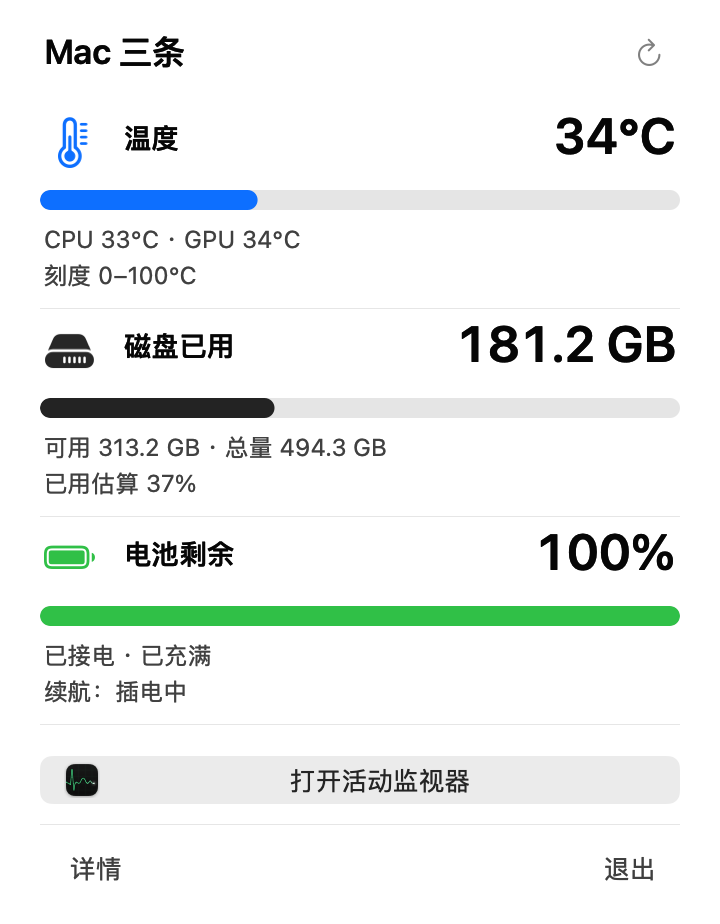

# MacMonitor · Mac 三条

一个菜单栏图标，同时看温度、磁盘空间与电量。三根竖条从左到右分别表示温度、磁盘已用比例、电池剩余；点击图标可看具体数字。



## 下载与安装

从 [GitHub Releases](https://github.com/EOShoow/MacMonitor/releases) 下载 `MacMonitor-0.3.0-arm64.dmg` 或 `.zip`。

1. 打开 DMG，将 `MacMonitor.app` 拖入 Applications，然后打开 App。
2. 如需登录自动启动，可双击同目录的 `安装并启用自启动.command`。它将 App 安装到个人 Applications 并启用专用登录启动项，无需管理员密码；更新时自动备份上一版。
3. 菜单栏出现三条后，点击查看读数。底部“退出”会停止程序，自启动配置会在下次登录时再次打开。

首次下载的公开测试版使用 ad hoc 签名，**尚无 Developer ID 签名和 Apple 公证**。如果 macOS 阻止打开，请先核对仓库来源及 `SHA256SUMS.txt`，再按 [Apple 的官方说明](https://support.apple.com/zh-cn/102445) 在“系统设置 → 隐私与安全性”中针对这一个 App 选择“仍要打开”。无需关闭 Gatekeeper 或修改系统全局安全配置。

系统要求：**Apple Silicon、macOS 14 或更新版本**。构建目标与可执行文件最低系统版本均为 macOS 14；当前已在 macOS 27.0.1 实际运行验证，其他系统和芯片型号仍需试用。Intel Mac 暂不提供安装包。温度采样器已内置，使用安装包无需安装 Homebrew 或开发工具。

## 功能

- **温度**：CPU / GPU 平均温度取较高者，低温亮蓝、日常绿、高温橙、极高温红。颜色是显示分档，不作为硬件安全判断。
- **磁盘**：主目录所在卷的已用估算、已用比例、可用和总量；图标常态为浅银灰，容量紧张时变橙或红。显示十进制 GB，不扫描目录。
- **电量**：剩余比例、充电 / 接电状态；离电后根据真实电量下降样本估算续航，样本不足显示学习中。
- **活动监视器**：一键打开系统活动监视器，进一步查看 CPU、内存和能耗。
- **刷新与自启动**：温度每 5 秒、磁盘每 60 秒、电量监听通知并每 30 秒兜底；支持登录启动、手动刷新和睡眠唤醒恢复。

图标为 22 pt，深灰圆角底板隔开壁纸。温度和电量缺失时仅对应条显示短横线。没有内置电池的台式 Mac，电量条显示不可用。

## 本地数据与限制

App 不上传监测数据、不收集账号信息，也不自动结束其他进程。续航记录保存在 `~/.local/state/mac-monitor-preview/runtime-samples.json`，仅含时间、电量、电源状态和样本段标识。离电时每五分钟在本地读取进程负载，以判断是否重新学习续航；原始命令行不落盘、不显示排行。

温度使用 macmon 的私有系统接口，系统升级可能使读数暂时不可用。续航是基于近期负载的估算；接电暂停学习，长期准确度仍需试用。此版本不自动切换系统低电量模式。

## 从源码构建

需要 Apple Silicon 和 Xcode Command Line Tools。首次构建下载并验证固定的 macmon v0.7.2 官方归档。

```bash
./build.sh
build/MacMonitorPreview.app/Contents/MacOS/MacMonitorPreview --self-test
open build/MacMonitorPreview.app
```

`./install.sh` 将本地构建安装到个人 Applications 并启用登录启动；`./run.sh` 重新启动同一实例。`./release.sh` 生成 DMG、ZIP 和 SHA-256 校验文件。`./export-public.sh` 生成仅包含本 App 的公开源码目录，不复制本机历史和运行快照。

## 许可

MacMonitor 使用 [MIT License](LICENSE)。温度采样器 [macmon v0.7.2](https://github.com/vladkens/macmon/releases/tag/v0.7.2) 使用 MIT License，许可和归档校验值见 [第三方说明](THIRD_PARTY_NOTICES.md)。
